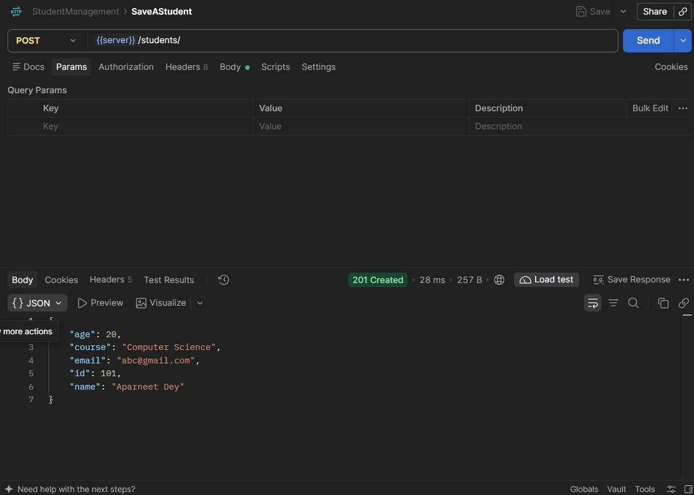
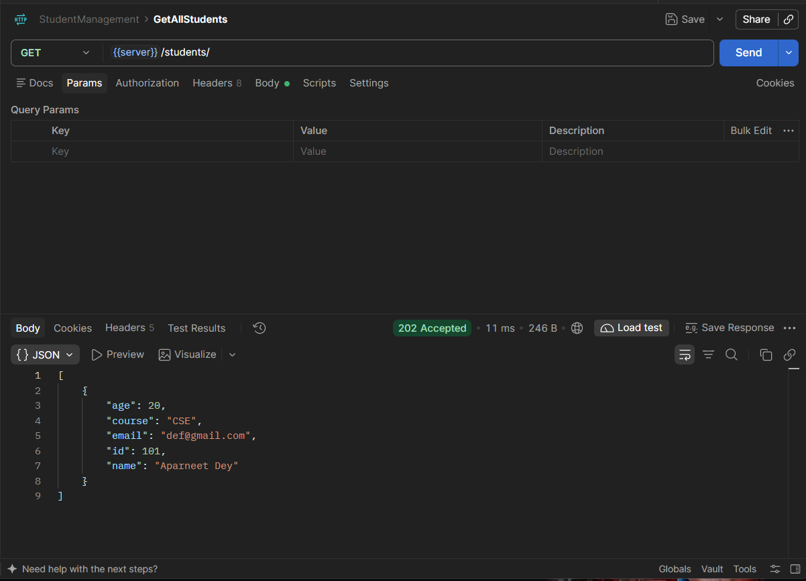
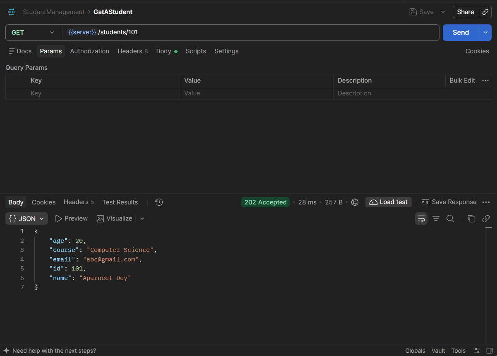
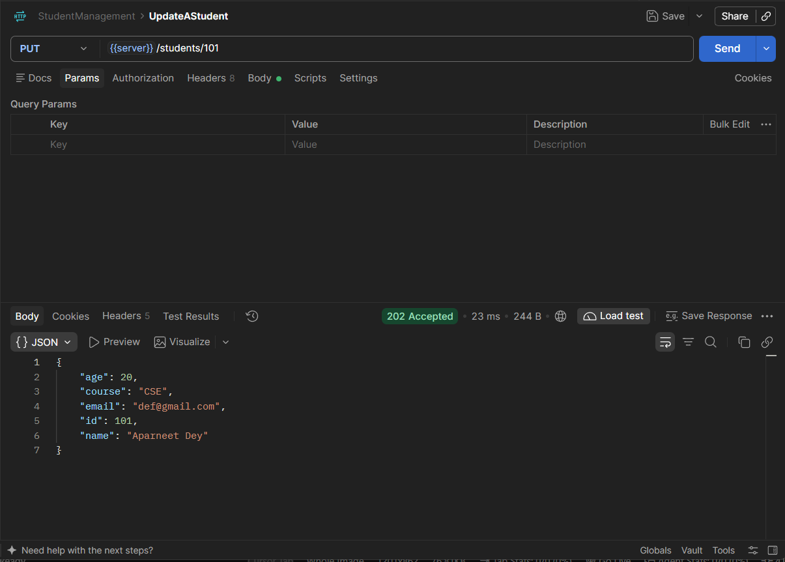
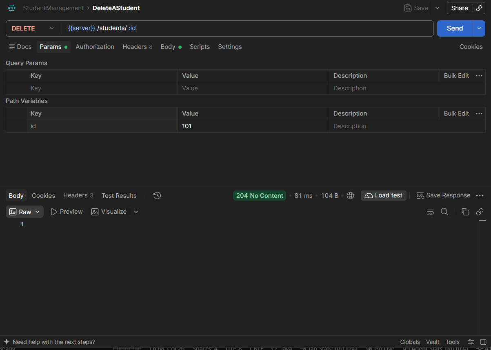
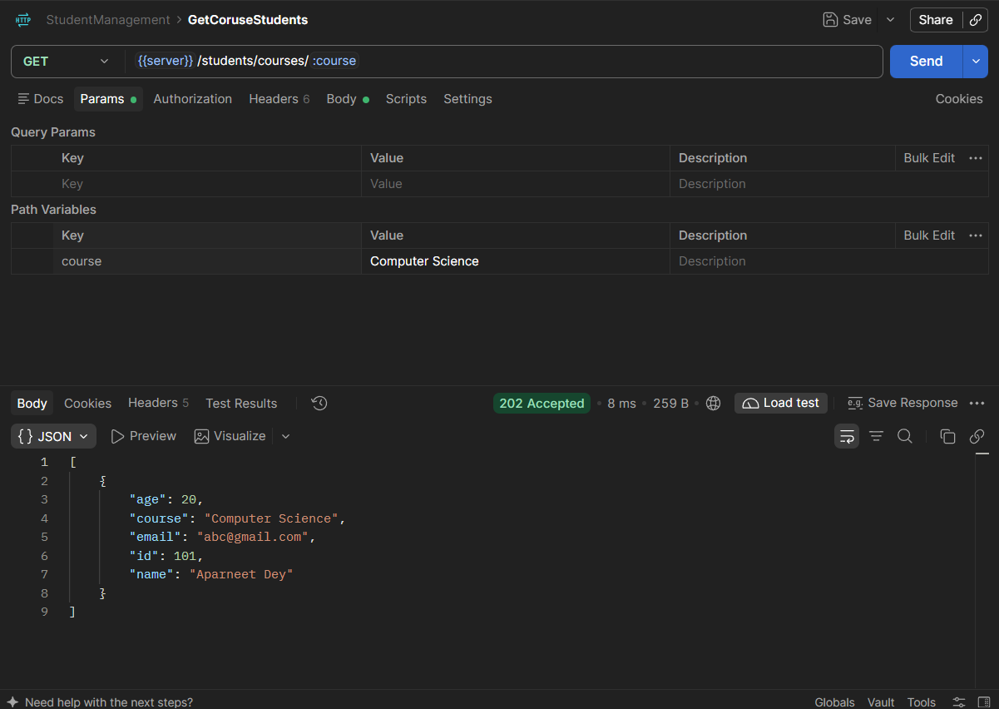

# Spring Student Management

REST API for CRUD on students, built with Spring Boot 4, Spring Data JPA, and MySQL. Classic layered layout: `StudentController` → `StudentService` → `StudentRepository` (`JpaRepository<Student, Integer>`).

App lives in [`management/`](management/). Hibernate `ddl-auto=update` owns the schema — there is no Flyway/Liquibase.

**Stack:** Java 21, Spring Boot 4.1.2, Spring Web MVC, Spring Data JPA, MySQL Connector/J, Lombok.

---

## Run it

1. MySQL on `127.0.0.1:3306`. Database `spring_projects` is created if missing (`createDatabaseIfNotExist=true`).
2. Credentials go in [`management/src/main/resources/application.properties`](management/src/main/resources/application.properties). Do not commit real passwords.
3. From `management/`:

```bash
./mvnw spring-boot:run
```

Default port is **8080**. Base path for all student routes: **`/api/students`**.

Postman collection uses `{{server}}/students/...`. `{{server}}` is `http://localhost:8080/api`.

---

## Database schema

Single table `student`, mapped by [`Student`](management/src/main/java/com/backend/management/model/Student.java). **`id` is not generated** — the client sends it on create.

| Column   | Java type | SQL  |
| -------- | --------- | ----------------------- |
| `id`     | `int`     | `INT` PK                |
| `name`   | `String`  | `VARCHAR(255)`          |
| `email`  | `String`  | `VARCHAR(255)`          |
| `course` | `String`  | `VARCHAR(255)`          |
| `age`    | `int`     | `INT`                   |

```sql
CREATE TABLE student (
    id      INT          NOT NULL,
    name    VARCHAR(255),
    email   VARCHAR(255),
    course  VARCHAR(255),
    age     INT          NOT NULL,
    PRIMARY KEY (id)
);
```

Custom repo query: `List<Student> findByCourse(String course)` → `WHERE course = ?`.

---

## Endpoints

All JSON. Missing student on GET/PUT by id → **404**. Delete always returns **204** (no existence check).

| Method   | Path                          | Status (happy path) | Body |
| -------- | ----------------------------- | ------------------- | ---- |
| `POST`   | `/api/students/`              | `201 Created`       | `Student` JSON |
| `GET`    | `/api/students/`              | `202 Accepted`      | — |
| `GET`    | `/api/students/{id}`          | `202 Accepted`      | — |
| `PUT`    | `/api/students/{id}`          | `202 Accepted`      | `Student` JSON |
| `DELETE` | `/api/students/{id}`          | `204 No Content`    | — |
| `GET`    | `/api/students/courses/{course}` | `202 Accepted`   | — |

Request/response shape:

```json
{
  "id": 101,
  "name": "Aparneet Dey",
  "email": "abc@gmail.com",
  "course": "Computer Science",
  "age": 20
}
```

`PUT` checks the path `id` exists, then `save()`s the **body**. Body `id` is what actually gets persisted.

---

### POST `/api/students/` — create

`201 Created`. Example body: id `101`, course `Computer Science`.



---

### GET `/api/students/` — list all

`202 Accepted`. Array of students.



---

### GET `/api/students/{id}` — by id

`202 Accepted` or `404`. Screenshot: `GET .../students/101`.



---

### PUT `/api/students/{id}` — update

`202 Accepted` or `404`. Screenshot: id `101` updated to course `CSE`, email `def@gmail.com`.



---

### DELETE `/api/students/{id}` — delete

`204 No Content`. Path param `id` (screenshot uses `101`).



---

### GET `/api/students/courses/{course}` — filter by course

`202 Accepted`. Path is a string (`Computer Science` in the screenshot). Spaces in the URL must be encoded (`Computer%20Science`).


